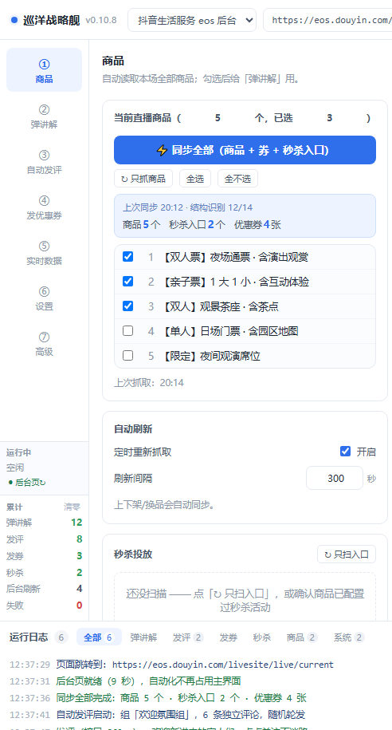
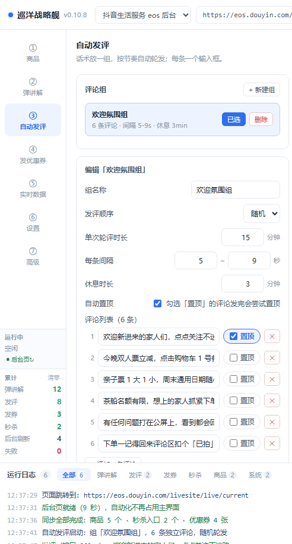

# 巡洋战略舰 · 抖音本地生活直播中控助手

给单机直播运营用的桌面中控台：内置浏览器登录抖音本地生活「直播专业版」中控台，把**抓商品、弹讲解、自动发评/回评、发优惠券、秒杀投放**这些重复动作变成可排队执行的自动化面板。Electron + 原生 JS，不依赖服务器，配置全在本地。



> 自用工具开源，不是商业产品。功能对着「一个运营盯一场直播」的真实场景做，界面里的商品/金额都是演示数据。

---

## 能力

| 模块 | 说明 |
|---|---|
| 商品同步 | 一次「⚡ 同步全部」把本场商品、优惠券列表、秒杀入口一起抓下来，勾选后供其它模块使用 |
| 定时弹讲解 | 按节奏轮流弹讲解卡片，支持「一直弹」常驻单卡模式 |
| 自动发评 / 回评 | 多条话术随机或顺序轮发，可选发完自动置顶；关键词自动回复 |
| 自动发优惠券 | 扫后台券列表（满减/折扣/代金），按档位（10/50/100/500/1000/全部库存）分批发放，可设间隔 |
| 秒杀投放 | 一键开启/停止秒杀、定时投放、剩余数量监控自动补充 |
| 实时数据 | 在线人数、观看、涨粉、成交、GMV 与单品明细 |
| 后台工作页 | 自动化跑在第二个隐藏页面（同登录态），主界面你可以随便滚随便点，不会被打断 |
| 不抢鼠标 | 点击/输入走 CDP 注入，不移动系统光标、不抢焦点；真人一操作，机器人自动让位 3 秒 |
| 选择器校准 | 抖音后台 class 是随机哈希，会随版本变；选择器全部可配置，支持手填/拾取/一键分析 |
| 结构分析 | 「高级」页一键探测后台结构，按功能分组列出命中的选择器，改版后先跑这个 |



## 快速开始

**下载现成包（macOS Apple 芯片）**：到 [Releases](https://github.com/AYuanNmmmm/xunyang-zhanluejian/releases) 下 `xunyang-zhanluejian-macOS-arm64-v0.10.8.zip`，解压得到 `巡洋战略舰.app`，拖进「应用程序」。首次打开右键 →「打开」；若提示「已损坏 / 无法验证开发者」，执行一次：

```bash
xattr -cr /Applications/巡洋战略舰.app
```

**下载现成包（Windows x64）**：到 [Releases](https://github.com/AYuanNmmmm/xunyang-zhanluejian/releases) 下 `xunyang-zhanluejian-windows-x64-v0.10.8-setup.exe`，双击安装，安装向导可自选目录（中文、桌面与开始菜单快捷方式）。首次运行若被 SmartScreen 拦，点「更多信息 → 仍要运行」（未做代码签名）。

**从源码跑**：

```bash
git clone https://github.com/AYuanNmmmm/xunyang-zhanluejian.git
cd xunyang-zhanluejian
npm install --no-audit --no-fund
npm start
```

Electron 二进制没下下来时补一次：`ELECTRON_MIRROR=https://npmmirror.com/mirrors/electron/ node node_modules/electron/install.js`

Windows 源码版也可以直接双击：`首次安装.bat`（首次装依赖）→ `start.bat`。macOS 双击 `首次安装.command` → `start.command`。

## 第一次用必做：登录 + 抓商品

出厂包**不带任何商品/券/秒杀数据**——那些属于你自己直播间，必须自己抓。

1. 打开 app，等右侧中控台加载完，扫码登录抖音账号
2. 进入直播中控台（需要已开播，部分接口只在开播时可用）
3. 左侧「① 商品」→ 点「⚡ 同步全部」，约 10 秒把商品/券/秒杀入口抓齐
4. 勾选要讲解的商品 → 其它模块就有数据了
5. 选择器对不上（抖音改版了）→ 去「⑦ 高级」点「🔍 只分析结构」，再回来重新抓

配置文件位置：

- macOS：`~/Library/Application Support/巡洋战略舰/config.json`
- Windows：`%APPDATA%\巡洋战略舰\config.json`

## 数据与隐私

- **全本地**：没有后端、没有账号体系、不上报任何数据。唯一的网络请求是你自己浏览器页面访问的抖音后台。
- **登录态**在 Electron 的浏览器会话里，等同于你在浏览器里登录，工具本身不读 cookie、不存密码。
- **配置**只写本地 `config.json`，含你绑定的选择器和话术。仓库里的 `data/config.default.json` 是脱敏出厂模板（商品/券/秒杀/评论组全空）。
- **仓库不含**：`data/config.json`、`data/probe*/`（后台结构抓取产物）、`data/chrome-profile/`（登录态）、打包产物、`node_modules/`。

## 打包

```bash
# macOS（必须在 macOS 上执行，electron-builder 26 起不支持跨平台构建 mac）
bash scripts/build-mac.sh --arm64-only       # 或去掉参数出 arm64 + x64

# Windows
npm run dist:win                            # 产物在 release/
```

产物在 `release/`。macOS 包未做 Apple 签名/公证，首次打开需要 `xattr -cr`。

## 测试

```bash
npm run test:ui        # 界面与调度回归：41 项
npm run test:auto      # 注入、frame、定位、点击注入：42 项
./node_modules/.bin/electron --no-sandbox test/scheme-guard.js   # 唤端协议拦截：8 项
```

预期共 **91 项全过**。注意 `test:auto` 自带静态服务占用 127.0.0.1:8899，端口被别的服务占着时会读到别人的页面导致大面积 FAIL。

## 目录结构

```
main.js / preload.js / guest.js   主进程、安全桥接、内嵌页面操作层
src/                              界面（index.html / styles.css / app.js 渲染与调度引擎）
scripts/                          出厂配置生成校验、源码打包、Mac 出包、后台结构探针
build/                            图标（svg/png/ico/icns）与 NSIS 安装器脚本
test/                             界面、注入、协议拦截、并发压测等自测脚本
data/config.default.json          脱敏出厂配置
docs/                             使用说明与版本历史、交接文档、出包说明、发布记录
screenshots/                      README 用图（演示数据）
```

## 已知限制

- **强依赖抖音后台的 DOM**。class 是随机哈希、结构随版本变；改版后需要重新跑「结构分析」并校准选择器，这是这类工具的通病，不是 bug。
- **只在开播状态下功能完整**。未开播时部分接口/元素不存在，日志会提示「后台页启动失败…将在后台自动重试」，开播后自动消失。
- **macOS 包只有 arm64**（Apple 芯片）。Intel 机器请用源码版或自行 `bash scripts/build-mac.sh` 出 x64。
- **Windows 安装包是 10-23 构建的 0.10.8 定版**，不含 10-26 那次 macOS 闪退修复里同样影响 Windows 的两处改动（健康探针、Electron 版本）。不影响启动，但下播后后台页可能自动刷新一次；要完全对齐源码请自行 `npm run dist:win`。
- **不做 Apple 签名**，所以首次打开要手动放行。
- 秒杀的「剩余数量自动补充」需要先真实投放一次后台才显示「剩余」文案，属后台行为限制。

## 免责声明

本项目为个人自用工具的开源存档，仅供学习 Electron 自动化与界面注入参考。使用者需自行遵守抖音平台规则与相关法律法规；自动化操作存在被平台风控的可能，账号风险自负。作者不对因使用本工具造成的任何账号、数据或经营损失负责。

## License

[MIT](LICENSE)
